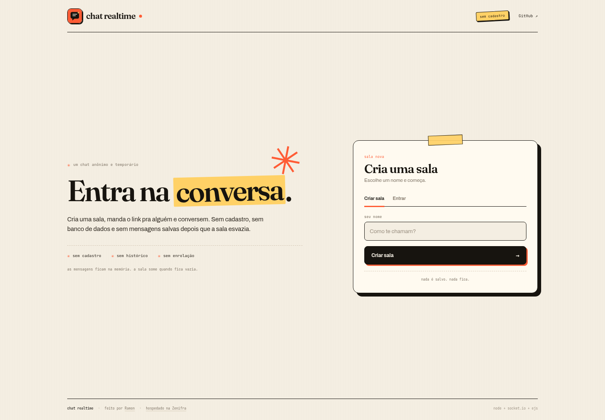
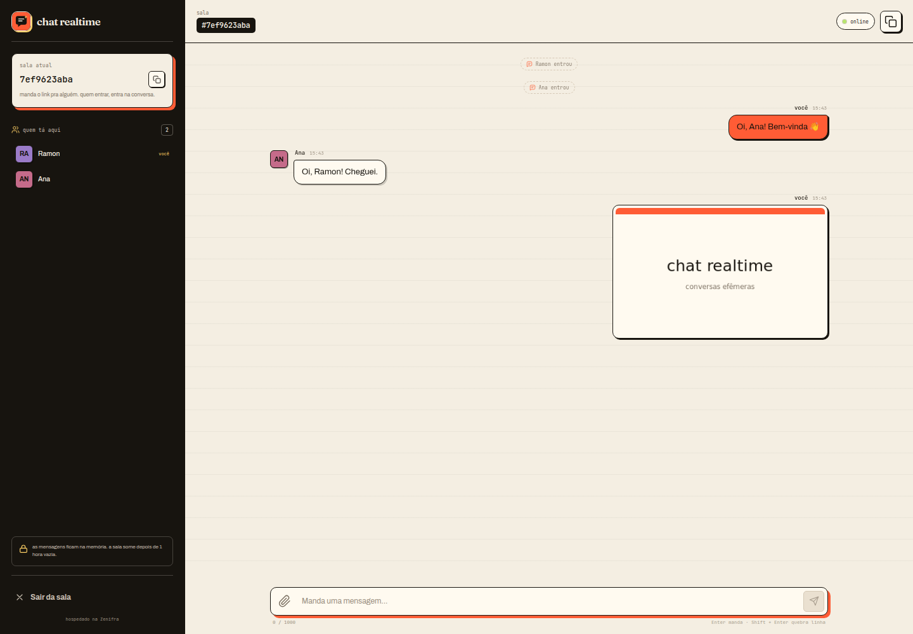
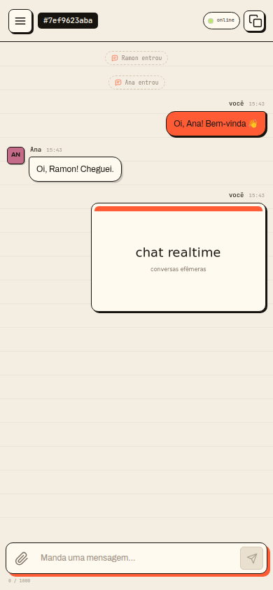

# chat realtime

Um chat anônimo e temporário. Cria uma sala, manda o link e conversa. Sem cadastro, sem banco de dados — as mensagens ficam só na memória e a sala some quando fica vazia.

[](https://console.zenifra.com/deploy?repository=https://github.com/ramonpaolo/chat-realtime&port=3000&name=chat-realtime&branch=main&runtime=nodejs&version=22&start=yarn%20start&build=yarn%20build)

**App:** [chat-realtime.clients.zenifra.com](https://chat-realtime.clients.zenifra.com)

O badge abre o Console da Zenifra com este repositório, a porta `3000`, Node 22, `yarn build` e `yarn start` já preenchidos. O repositório é público; o deploy não exige conectar sua conta GitHub.



## O que tem

- Salas por link, com código curto.
- Mensagens, presença e “digitando” em tempo real via Socket.io.
- Imagens, vídeos, PDFs e texto até 4 MB, com no máximo 3 anexos por envio.
- Sem cadastro e sem histórico em banco: o estado vive na memória do processo.
- Salas vazias expiram depois de 1 hora.
- Layout responsivo para desktop e celular.





## Rodando local

```bash
yarn install
yarn test
yarn build
PORT=3000 yarn start
```

Para desenvolver com reload do servidor:

```bash
yarn dev
```

## Docker

```bash
docker build -t chat-realtime .
docker run --rm -p 3000:3000 chat-realtime
```

A imagem usa Node 22 Alpine, roda como usuário `node` e expõe o healthcheck em `GET /healthz`.

## Limites e segurança

- Validação de nomes, mensagens, códigos de sala e arquivos.
- Limite de 4 MB por arquivo, 3 anexos por envio e 30 pessoas por sala.
- Rate-limit de mensagens, arquivos e criação de salas.
- CSP, headers de segurança e `maxHttpBufferSize` reduzido.
- Salas vazias são limpas periodicamente; o servidor tem limite de 500 salas.
- Não há banco de dados, cookies de sessão ou perfis.

## Stack

TypeScript, Node.js 22+, Express 5, Socket.io e EJS. A interface é CSS próprio, sem framework de UI.

## Licença

MIT.
